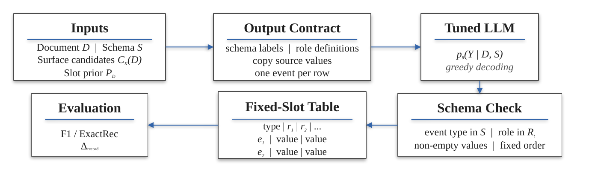
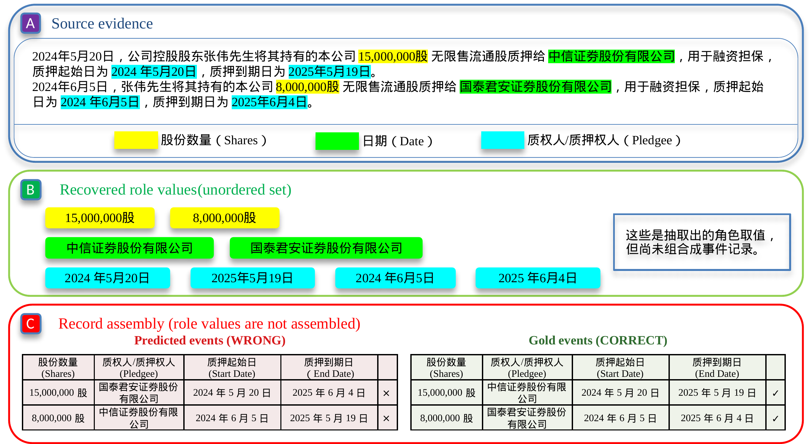

# SARGE

**Schema-Grounded Event-Table Generation for Chinese Financial Document-Level Event Extraction**

[中文说明](README_ZH.md) · [Final paper (PDF)](paper/SARGE_CCKS2026.pdf)

SARGE (Schema-Aware Role-Grounded Extractor) formulates closed-schema
document-level event extraction as event-table generation. Given a financial
document and an event schema, it grounds event types and roles to the schema,
copies surface values from the source document, and emits fixed-slot event
records that can be evaluated without label repair or semantic matching.



This public branch is deliberately small. It contains the data preparation,
training, inference, and evaluation paths needed to reproduce the paper. Raw
datasets, model weights, checkpoints, generated predictions, and internal
experiment logs are not committed.

## Paper results

The final paper reports the following three-seed results (seeds 13, 17, and
42):

| Dataset | Role F1 | ExactRec | ΔRec |
|---|---:|---:|---:|
| ChFinAnn | 85.6 ± 0.4 | 56.1 | 29.5 |
| DuEE-Fin | 78.3 ± 0.4 | 43.3 | 35.1 |

The seed-13 role F1 scores are 86.0 on ChFinAnn and 78.0 on DuEE-Fin.
`ExactRec` requires an entire schema-ordered event record to match, while
`ΔRec = F1 − ExactRec` is a diagnostic gap. It should not be interpreted as a
pure measure of record binding error.

These results do not constitute a claim that SARGE solves homogeneous-record
assembly or uniformly outperforms prior systems. In particular, record binding
remains an important limitation, and the paper's DuEE-Fin score is below
SEELE.



## Repository layout

```text
SARGE/
├── data/                 # schemas and aggregate split metadata only
├── docs/figures/         # selected figures from the final paper
├── evaluator/            # strict role F1, ExactRec, and ΔRec
├── paper/                # final paper PDF, LaTeX source, and CCKS poster
├── scripts/              # data preparation, training, merge, and inference
├── src/sarge/            # extraction package
└── tests/                # CPU-only public reproducibility tests
```

## Installation

Python 3.10 or newer and [uv](https://docs.astral.sh/uv/) are recommended.

```bash
uv venv
uv sync --extra dev
```

Training and real-model inference require the optional server stack:

```bash
uv sync --extra server --extra dev
```

Keep the base model locally at
`models/Qwen/Qwen3-4B-Instruct-2507`. Reproduction runs are intended to be
offline:

```bash
export HF_HUB_OFFLINE=1
export TRANSFORMERS_OFFLINE=1
export HF_DATASETS_OFFLINE=1
```

## Prepare the public datasets

Download the source datasets from their official public locations:

- [ChFinAnn / Doc2EDAG](https://github.com/shun-zheng/Doc2EDAG)
- [DuEE-Fin](https://aistudio.baidu.com/datasetdetail/186939)

Arrange the downloaded files as follows:

```text
data/raw/
├── ChFinAnn/
│   ├── train.json
│   ├── dev.json
│   └── test.json
└── DuEE-Fin/
    ├── duee_fin_train.json
    ├── duee_fin_dev.json
    └── duee_fin_test.json
```

Then build the processed splits:

```bash
uv run python -B scripts/prepare_public_data.py \
  --raw-root data/raw \
  --out-root data
```

ChFinAnn preserves the upstream train/dev/test split. For DuEE-Fin, the
official labeled development file is the paper test split; the official
training file is deterministically divided into train and a 500-document
development split using seed 42 and event-signature stratification. Aggregate
counts and the split policy are recorded in `data/*/split_manifest.json`.

## Train

The final configuration uses Qwen3-4B-Instruct-2507, two epochs, LoRA
`r=16`, `alpha=32`, dropout `0.05`, learning rate `2e-4`, a 4096-token
sequence limit, and a 1024-token generation limit.

ChFinAnn seed 13:

```bash
CUDA_VISIBLE_DEVICES=0 PYTHONPATH=src \
uv run python -B scripts/train_sft.py \
  --dataset ChFinAnn-Doc2EDAG \
  --epochs 2 \
  --grad-accum 8 \
  --lr 2e-4 \
  --seed 13 \
  --gpu 0
```

DuEE-Fin seed 13:

```bash
CUDA_VISIBLE_DEVICES=0 PYTHONPATH=src \
uv run python -B scripts/train_sft.py \
  --dataset DuEE-Fin-dev500 \
  --epochs 2 \
  --grad-accum 16 \
  --lr 2e-4 \
  --seed 13 \
  --gpu 0
```

For the three-seed results, repeat with seeds 17 and 42; use gradient
accumulation 16 for those runs. Each run writes its summary, checkpoints,
predictions, and evaluation artifacts under `runs/<run-name>/`.

## Infer

Run a LoRA checkpoint with the Transformers backend:

```bash
CUDA_VISIBLE_DEVICES=0 PYTHONPATH=src \
uv run python -B scripts/infer_checkpoint.py \
  --dataset DuEE-Fin-dev500 \
  --split test \
  --ckpt runs/<run-name>/artifacts/model/adapter \
  --model models/Qwen/Qwen3-4B-Instruct-2507 \
  --seed 13
```

For vLLM, merge the adapter first and use
`scripts/infer_checkpoint_vllm.py`. Add `--profile-latency` to write
`diagnostics/latency_summary.json`.

Canonical predictions are written to:

```text
runs/<run-id>/predictions/<dataset>/<split>.canonical.pred.jsonl
```

## Evaluate

The evaluator uses strict normalized surface-form matching. It does not apply
embedding similarity, alias expansion, semantic matching, or label repair.

```bash
PYTHONPATH=. uv run python -B -m evaluator role-f1 \
  --dataset DuEE-Fin-dev500 \
  --gold data/DuEE-Fin-dev500/test.jsonl \
  --pred runs/<run-id>/predictions/DuEE-Fin-dev500/test.canonical.pred.jsonl \
  --schema data/DuEE-Fin-dev500/schema.json \
  --out runs/<run-id>/eval/role_f1.json
```

The JSON report includes:

- `overall`: role-level micro precision, recall, and F1;
- `subset_metrics`: single-event and multi-event role scores;
- `record_metrics.exact_record`: order-insensitive exact-record P/R/F1;
- `record_metrics.delta_record`: role F1 minus ExactRec;
- `diagnostics`: role-slot and record-count checks.

Use `ChFinAnn-Doc2EDAG` and its corresponding paths for ChFinAnn.

## CPU verification

The public test suite does not require GPUs, model weights, or raw datasets:

```bash
PYTHONDONTWRITEBYTECODE=1 PYTHONPATH=src:. \
uv run python -B -m pytest tests/ -q
```

## Citation

```bibtex
@inproceedings{tong2026sarge,
  title     = {SARGE: Schema-Grounded Event-Table Generation for Chinese Financial Document-Level Event Extraction},
  author    = {Tong, Jiakai and Qin, Mengting and Hu, Yongqi and Wan, Xueyao and Zhao, Yue},
  booktitle = {China Conference on Knowledge Graph and Semantic Computing},
  year      = {2026}
}
```

## License

Released under the [MIT License](LICENSE). Dataset and model licenses remain
with their original providers.
