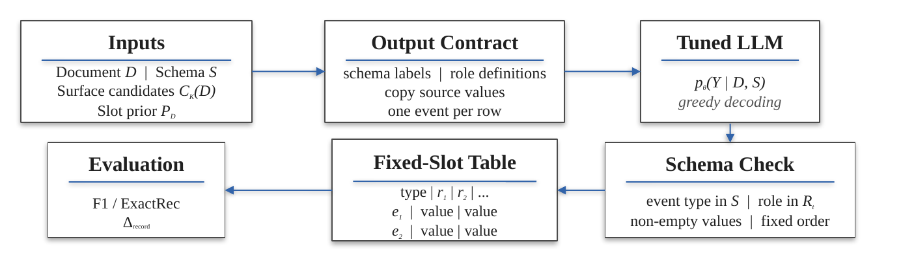
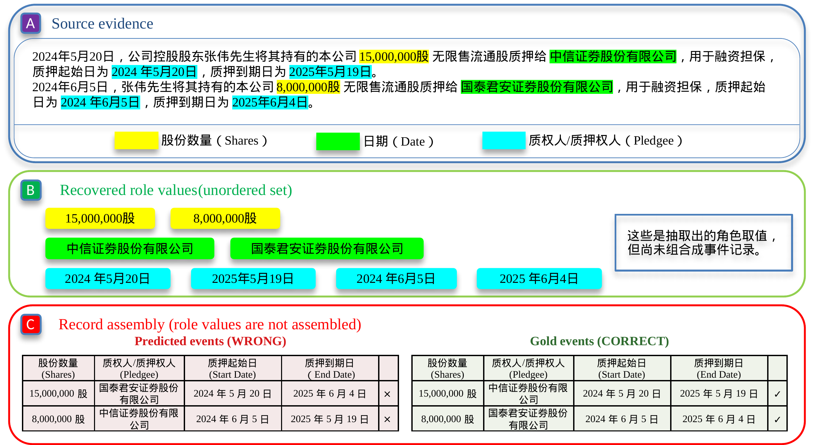

# SARGE

**面向中文金融文档级事件抽取的 Schema-Grounded Event-Table Generation**

[English README](README.md) · [最终英文论文（PDF）](paper/SARGE_CCKS2026.pdf)

SARGE（Schema-Aware Role-Grounded Extractor）将闭集事件模式下的文档级
事件抽取表述为事件表生成：输入金融文档与事件模式，模型按照给定 schema 约束
事件类型和角色，从原文中选择表面值，并输出可直接评测的定槽事件记录。



本分支专门用于 GitHub 对外展示与论文复现，只保留数据准备、训练、推理、评测和
CPU 测试所需的最基本代码。原始数据、模型权重、checkpoint、预测结果和内部实验
日志均不提交。

## 论文结果

最终论文报告了 seed 13、17、42 三个随机种子的结果：

| 数据集 | 角色 F1 | ExactRec | ΔRec |
|---|---:|---:|---:|
| ChFinAnn | 85.6 ± 0.4 | 56.1 | 29.5 |
| DuEE-Fin | 78.3 ± 0.4 | 43.3 | 35.1 |

seed 13 的角色 F1 分别为 ChFinAnn 86.0、DuEE-Fin 78.0。`ExactRec`
要求整条、按 schema 排列的事件记录完全匹配；`ΔRec = F1 − ExactRec` 只是
诊断性差值，不能简单等同为纯粹的记录绑定误差。

论文不声称 SARGE 已解决同类型多记录组装，也不声称全面优于已有系统。记录绑定
仍是明确边界；论文中的 DuEE-Fin 结果也低于 SEELE。



## 目录

```text
SARGE/
├── data/                 # schema 与汇总后的划分元数据
├── docs/figures/         # 最终论文中的选定插图
├── evaluator/            # 严格角色 F1、ExactRec 与 ΔRec
├── paper/                # 最终英文论文 PDF
├── scripts/              # 数据准备、训练、合并与推理脚本
├── src/sarge/            # 抽取系统代码
└── tests/                # 不依赖 GPU 的公开复现测试
```

## 安装

推荐 Python 3.10+ 与 [uv](https://docs.astral.sh/uv/)：

```bash
uv venv
uv sync --extra dev
```

训练和真实模型推理还需要服务器依赖：

```bash
uv sync --extra server --extra dev
```

将 Qwen3-4B-Instruct-2507 放在
`models/Qwen/Qwen3-4B-Instruct-2507`，并按离线方式运行：

```bash
export HF_HUB_OFFLINE=1
export TRANSFORMERS_OFFLINE=1
export HF_DATASETS_OFFLINE=1
```

## 准备公开数据

请从原始发布方下载：

- [ChFinAnn / Doc2EDAG](https://github.com/shun-zheng/Doc2EDAG)
- [DuEE-Fin](https://aistudio.baidu.com/datasetdetail/186939)

放置目录：

```text
data/raw/
├── ChFinAnn/
│   ├── train.json
│   ├── dev.json
│   └── test.json
└── DuEE-Fin/
    ├── duee_fin_train.json
    ├── duee_fin_dev.json
    └── duee_fin_test.json
```

生成处理后的数据：

```bash
uv run python -B scripts/prepare_public_data.py \
  --raw-root data/raw \
  --out-root data
```

ChFinAnn 保留上游 train/dev/test 划分。DuEE-Fin 将官方有标签 dev 作为论文
test；官方 train 按 seed 42 和事件签名分层，确定性地划出 500 条 dev。
`data/*/split_manifest.json` 只记录汇总统计和划分规则。

## 训练

终稿配置为 Qwen3-4B-Instruct-2507、2 epochs、LoRA `r=16`、
`alpha=32`、dropout `0.05`、学习率 `2e-4`、最大序列长度 4096、最大
生成长度 1024。

ChFinAnn seed 13：

```bash
CUDA_VISIBLE_DEVICES=0 PYTHONPATH=src \
uv run python -B scripts/train_sft.py \
  --dataset ChFinAnn-Doc2EDAG \
  --epochs 2 \
  --grad-accum 8 \
  --lr 2e-4 \
  --seed 13 \
  --gpu 0
```

DuEE-Fin seed 13：

```bash
CUDA_VISIBLE_DEVICES=0 PYTHONPATH=src \
uv run python -B scripts/train_sft.py \
  --dataset DuEE-Fin-dev500 \
  --epochs 2 \
  --grad-accum 16 \
  --lr 2e-4 \
  --seed 13 \
  --gpu 0
```

三种子结果还需重复 seed 17 和 42；这些补充运行均使用 gradient accumulation
16。产物统一写入 `runs/<run-name>/`。

## 推理

使用 Transformers 后端加载 LoRA：

```bash
CUDA_VISIBLE_DEVICES=0 PYTHONPATH=src \
uv run python -B scripts/infer_checkpoint.py \
  --dataset DuEE-Fin-dev500 \
  --split test \
  --ckpt runs/<run-name>/artifacts/model/adapter \
  --model models/Qwen/Qwen3-4B-Instruct-2507 \
  --seed 13
```

使用 vLLM 时，先运行 `scripts/merge_lora_to_bf16.py`，再运行
`scripts/infer_checkpoint_vllm.py`。添加 `--profile-latency` 会生成
`diagnostics/latency_summary.json`。

标准预测文件位于：

```text
runs/<run-id>/predictions/<dataset>/<split>.canonical.pred.jsonl
```

## 评测

评测采用严格的归一化原文表面值匹配，不使用向量相似度、别名扩展、语义匹配或
标签修复：

```bash
PYTHONPATH=. uv run python -B -m evaluator role-f1 \
  --dataset DuEE-Fin-dev500 \
  --gold data/DuEE-Fin-dev500/test.jsonl \
  --pred runs/<run-id>/predictions/DuEE-Fin-dev500/test.canonical.pred.jsonl \
  --schema data/DuEE-Fin-dev500/schema.json \
  --out runs/<run-id>/eval/role_f1.json
```

输出 JSON 包含整体角色 P/R/F1、单事件与多事件子集、ExactRec、ΔRec 以及相关
诊断计数。ChFinAnn 只需替换数据集名和对应路径。

## CPU 验证

公开测试不需要 GPU、模型权重或原始数据：

```bash
PYTHONDONTWRITEBYTECODE=1 PYTHONPATH=src:. \
uv run python -B -m pytest tests/ -q
```

## 引用与许可证

引用信息见 [CITATION.cff](CITATION.cff)；BibTeX 见英文 README。项目代码采用
[MIT License](LICENSE)，数据与模型仍遵循原始发布方的许可证。
